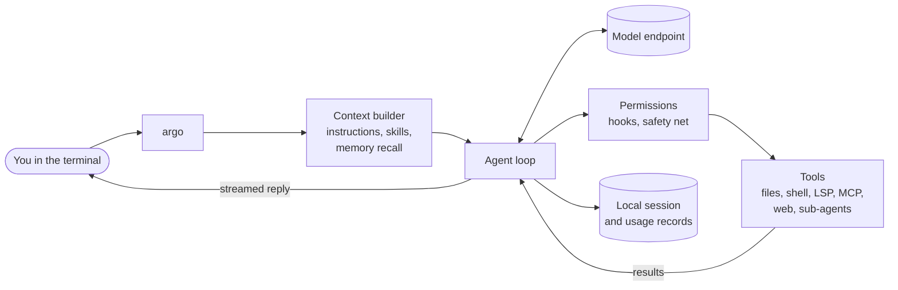

# Argonauts

Argonauts (`argo`) is a terminal coding agent written in TypeScript. It reads and searches files, edits code, runs shell commands, and streams replies in your terminal. It talks to OpenAI-compatible endpoints, keeps sessions and usage records on your own computer, and sends no telemetry.

This repository is a public overview. The source code is not published yet.

## What it does

**Models and sign-in**
- Works with OpenAI-compatible Chat Completions and Responses endpoints, including OpenRouter and local servers.
- ChatGPT sign-in is available as an alternative to an API key.
- `argo setup` (or `/setup`) walks through an endpoint preset, key check, model list and default model.
- Main-model `fallbacks` give an ordered list of models to try when the first one fails.
- Cost is tracked per provider and model.

**Tools and editing**
- Read, write, edit, `apply_patch`, glob and grep, shell, and `pty` for interactive programs.
- Hash-anchored edits and undo checkpoints.
- Language servers give diagnostics after edits, definitions, references and rename.
- A live project map and a `widget` tool for small tables, bars, checklists and trees, shown in a split pane.
- Web search and fetch, image input, and Windows desktop control (`desktop_look`, `desktop_act`).
- Plan mode for reading and planning before any change.

**Sub-agents, factory and dispatch**
- The `task` tool delegates work to the bundled `scout`, `researcher`, `planner`, `reviewer` and `worker` agents, or to your own agent files.
- `/goal` runs toward a verified check. Keyword modes such as `ulw` and todos help with longer jobs.
- Factory mode (`argo factory start`) runs a detached supervisor that splits a goal into jobs, runs workers, and gates merges.
- `/dispatch` hands work to an external agent and tracks its jobs, turns and verdicts.

**MCP, skills and hooks**
- MCP servers add tools from outside programs.
- Skills are folders with a `SKILL.md`. Prompt commands work the same way.
- Hooks run your own commands around tool calls, with project trust checks before project-level hooks run.
- Self-learning reviews finished tasks in the background and saves small lessons. `/learned` lets you keep, undo or pin each one.

**Memory**
- The brain is a folder of linked Markdown notes with dates and sources. You can open it in an editor or as an Obsidian vault.
- A keeper saves facts and recall brings them back into later sessions. Optional embeddings improve recall.
- Automatic compaction summarizes older turns when a session grows long.

**Sessions and usage**
- Sessions are local JSONL files. Resume with `argo -c`, `argo -r` or `/resume`, and fork or hand off work.
- `/usage` shows the current session. `argo usage` reports all sessions by period, provider, model, role and session.
- `argo doctor` runs local health checks and prints a fix for each warning.

**Safety and sandboxing**
- Yolo is the default permission mode. `argo --ask` turns on approval prompts for writes, edits and shell commands.
- A small catastrophic-command safety net and secret redaction are on by default.
- On Windows, shell commands, background jobs and PTY programs can run inside job objects with memory, CPU-time and process limits. Factory workers and self-upgrade builds use them by default.

**Windows, Linux and terminal looks**
- Windows 11 is the primary platform. Linux (Ubuntu 24.04 x64) is supported too.
- The startup banner is a braille drawing of the Argo in the Aegean Gilt palette, with an ASCII fallback for plain terminals.
- An editor with history search, a split pane, mouse support and optional animations.

## A typical session

1. Run `argo setup` once to pick an endpoint and a model.
2. Start `argo` in a project folder and describe the task.
3. Watch the replies stream. Tool calls and edits show up inline.
4. Use `/compact` when a session gets long, `/usage` to see cost, and `/resume` to return later.
5. For bigger jobs, set a `/goal`, let sub-agents split the work, or start a factory run.

## Slash commands you will see most

| Command | What it does |
| --- | --- |
| `/model` | Pick or add a model. |
| `/goal` | Work toward a goal with verified checks. |
| `/map` | Open the split pane with the live project map. |
| `/factory` | Start or show a factory run. |
| `/dispatch` | List external-agent dispatch jobs. |
| `/learned` | Review what self-learning saved. |
| `/usage` | Show tokens and cost for the session. |
| `/sandbox` | Show or change shell sandboxing. |
| `/compact` | Summarize older turns now. |
| `/resume` | Open another saved session. |

## Principles

- Local first. Sessions, memory and usage stay on your computer.
- No telemetry, no update check, no upload service.
- Argo only contacts your model endpoint, ChatGPT sign-in when you choose it, MCP URLs you configure, and web tools when enabled.
- Plain files you can read: JSONL sessions, Markdown notes, JSON config.
- Sharp edges are named. Yolo mode and the sandbox limits are documented, not hidden.

## How it works

You type a prompt. Argo adds your instructions, the skills index and any recalled notes, then sends it to the model. The model streams a reply and may ask for tools. Each tool call passes the permission checks and hooks, runs, and returns its result to the model. The loop repeats until the model has no more tool calls. Everything is written to a local session file.

## Status

- Current version: 1.6.0.
- Windows first, with Linux support.
- Source code and install instructions are not published yet.

## License

Will be published together with the source.
